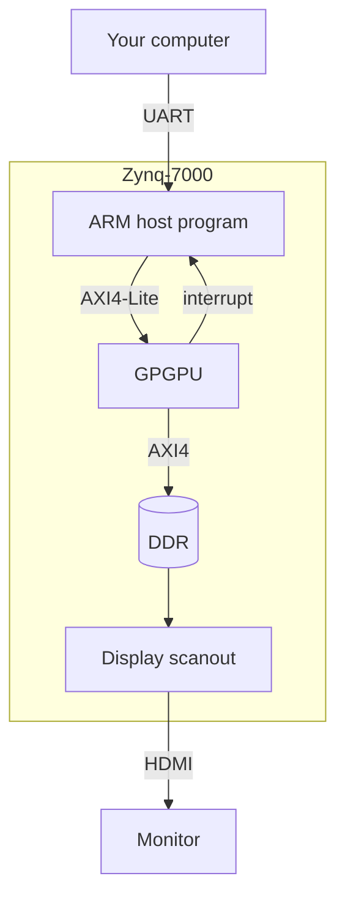

# ECE338 GPGPU

A small general-purpose GPU for FPGAs, written in SystemVerilog. You write a
kernel in C, the RISC-V compiler builds it, and every lane of the GPU runs it at
the same time on its own data.

> **Note:** This manual is being written. It has the build and test guides for
> now; the other chapters follow.

## The system

The GPU is one streaming multiprocessor. It fetches one instruction at a time,
and all its lanes, the streaming processors, execute it in lockstep. The number
of lanes is a configuration option.

- The **host program** runs on the ARM processor of the Zynq. It loads a kernel
  and its arguments, starts it, and waits for the interrupt that ends it. You
  control it over a serial port.
- A **kernel** works on the block RAM inside the GPU, and on DDR memory. Two
  regions of DDR are framebuffers.
- The **display scanout** shows a framebuffer on HDMI, without the help of the
  GPU or the host.

## What a kernel cannot do

- **Lanes cannot take different branches.** Every lane follows lane 0, so a
  branch must go the same way in all of them. The hardware does not check this.
- **There is no division.** The compiler accepts `/` and `%` and may produce
  division instructions, which give a wrong result without an error.

> **Note:** Branch divergence is planned.

## Where things are

| Folder | What is in it |
| --- | --- |
| `hardware/rtl/gpgpu/` | The GPU, in SystemVerilog |
| `hardware/bd/` | The Vivado block design around it |
| `software/programs/` | Kernels, and the runtime they use |
| `software/host/` | The host program and its driver |
| `tests/hardware/rtl/` | The RTL test benches and test cases |
| `tools/gpgpu/` | The `./gpgpu` command, which builds, tests and runs all of it |
| `config/` | The configuration of the command and of the hardware |
