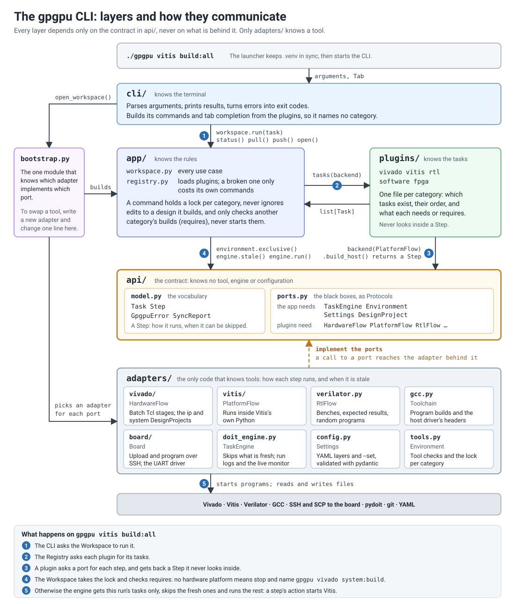

# The gpgpu CLI

```bash
./gpgpu vivado ip:create             # gpgpu <category> <task>, with its dependencies
./gpgpu fpga programs:simple:all
./gpgpu --set architecture.num_cores=2 vivado system:build
./gpgpu vivado system:bitstream      # or stop at any stage of the hardware build
./gpgpu vivado --help                # every task of a category, in flow order
./gpgpu project status system        # keep a GUI-edited design and its scripts in sync
./gpgpu config get hardware.vivado.jobs --source
./gpgpu doctor
```

For tab completion on `./gpgpu` and `gpgpu`, save the script once and load it from your
shell's rc file (`zsh` or `bash`):

```bash
./gpgpu completion zsh > ~/.gpgpu-completion
echo 'source ~/.gpgpu-completion' >> ~/.zshrc
```

To use `gpgpu` from anywhere in the repository, run `source .venv/bin/activate`.

## Folder structure



Each layer only knows the one below it, through `api/`. Only the last layer knows any tool.

```text
gpgpu                 the launcher: keeps .venv in sync, then runs the CLI
tools/gpgpu/
  cli/                parses arguments, calls the Workspace, prints. Builds its category
                      commands from whatever plugins exist
  app/                the rules: Workspace (use cases), Registry (loads plugins, isolates failures)
  api/                the contract: Task, Step, errors (model.py) and the black boxes (ports.py)
  plugins/            one file per category: what tasks exist, and in which order
  adapters/           the only code that knows tools: how each step runs, when it is stale
    config.py           YAML layers and --set
    design.py           facts shared between adapters: RTL files, output locations
    doit_engine.py      runs the graph (pydoit); run_log.py and run_monitor.py report it
    gcc.py              Toolchain: program builds; host_headers.py, slang.py: generated headers
    verilator.py        RtlFlow: identity, expected results, benches
    vivado/             HardwareFlow, its Tcl scripts, and the ip and system projects
    vitis/              PlatformFlow, and the script that runs inside Vitis's Python
    board/              Board over SSH, and the UART driver that runs on the board's machine
  bootstrap.py        the only module that knows which adapter implements which port
tools/tests/          the assembler and GPGPU model scripts that the rtl tasks run
tools/board/          the UART client, shared with fpga_run.py and the host tests
tests/cli/            basic checks, including the import rules below
```

What may import what (`tests/cli/test_cli.py` enforces it):

| Layer | May import | Knows |
| --- | --- | --- |
| `cli` | `api`, `bootstrap` | Terminals |
| `app` | `api` | Rules, such as "a build must not ignore committed edits" or "a command never starts another category's builds" |
| `plugins` | `api` | Task names, descriptions and their order |
| `adapters` | `api` | Vivado, Vitis, Verilator, GCC, SSH, pydoit, configuration |

## The two ideas

A **`Step`** says how something runs and when it can be skipped. Adapters build them.
A **`Task`** gives a step a name, a description and its place in the graph. Plugins declare
them, and treat each step as a black box:

```python
Task("vivado:ip:create", "Recreate the IP development project from the production RTL.",
     flow.create_ip(), needs=("vivado:_identity",))
```

The first word of the name is the category, and the plugin's file name. So this task runs
as `gpgpu vivado ip:create`. It appears in `--help` and tab completion by itself.

## How categories depend on each other

A command runs its own category's tasks and leaves the others alone: `gpgpu vitis build:all`
never starts Vivado. A task says what it depends on in two ways:

| Field | Use it for | Effect |
| --- | --- | --- |
| `needs` | Earlier tasks of the same category | They run first, if stale |
| `requires` | Another category's results | Never run. Missing outputs stop the command before anything runs, and name the command to run. Stale ones print a warning, then the command goes on |

```text
$ gpgpu vitis build:all
error: gpgpu vitis build:all cannot start without gpgpu_platform.xsa
hint: Run `gpgpu vivado system:build`

$ gpgpu vitis build:all
warning: `gpgpu vivado system:build` is out of date (ALU.sv changed): using its existing results
```

The one exception is `software`, whose tasks only generate files, in seconds: `needs` may name
them, so `gpgpu fpga programs:simple:all` still compiles the program it runs, and a stale image
cannot reach the board with only a warning. `tests/cli/test_cli.py` enforces this rule.

Only the tasks of the run reach the engine. pydoit would otherwise run the producer of any input
it knows about, so a file another task produces must be declared in `needs` or `requires`; the
same test file checks that too.

## Running two commands at once

One command at a time per category of a build tree, enforced by a lock. A command also holds the
categories it `requires`, so `gpgpu vitis build:all` refuses to start during `gpgpu vivado system:build`,
whose outputs it reads, while `gpgpu rtl e2e:all` runs fine beside it. The kernel frees the lock when
a command ends, however it ends, so a lock can never go stale.

## How to add a command

**A new task in an existing category** takes two edits. For example, `gpgpu rtl lint`:

1. Say how it runs, in the category's adapter (`adapters/verilator.py`), and add the method
   to the port it implements (`RtlFlow` in `api/ports.py`):

   ```python
   def lint(self) -> Step:
       sources, headers = rtl_sources(self._config, ["experimental", "HostControllerProcessor.sv"])
       command = [self._config.tool("verilator"), "--lint-only", "--sv", "-Wno-fatal",
                  f"-I{rtl_root(self._config)}", *map(str, sources)]
       return Step(partial(run, command), inputs=(*sources, *headers), fingerprint={"command": command})
   ```

2. Declare it, in the category's plugin (`plugins/rtl.py`):

   ```python
   Task("rtl:lint", "Lint the production RTL.", rtl.lint()),
   ```

The `Step` decides when the task is skipped:

| Field | Task reruns when |
| --- | --- |
| `inputs` | One of these files changes |
| `outputs` | One of these files is missing. Its content is never checked |
| `fingerprint` | These settings change. They must be JSON values |
| `checks` | A function returns false, or a `StateProbe`'s value changes |
| `always_run` | Always. Use it for anything acting on the outside world |

A step with no `inputs`, `fingerprint` or `checks` always runs. A task with no step only
groups its `needs`. A name whose last word starts with `_` is an internal stage, hidden
from help.

**A new category** takes one new plugin and one new adapter. For example, `gpgpu docs`:

1. `api/ports.py`: describe the black box.

   ```python
   class DocsFlow(Protocol):
       def build(self) -> Step: ...
   ```

2. `adapters/docs.py`: implement it. The constructor receives the `Config`. Declare the
   settings it reads as a `Section`, and they are validated before any task runs.

   ```python
   class _Docs(Section):
       output: str

   class SphinxDocs:
       def __init__(self, config: Config) -> None:
           self._s = config.section("docs", _Docs)
           ...

       def build(self) -> Step: ...
   ```

3. `bootstrap.py`: add `DocsFlow: "gpgpu.adapters.docs:SphinxDocs"` to `_BACKENDS`.

4. `plugins/docs.py`: declare the tasks. Its docstring's first line is the category's help.

   ```python
   """Build the documentation."""
   from gpgpu.api import Backends, DocsFlow, Task

   def tasks(backend: Backends) -> list[Task]:
       return [Task("docs:build", "Build the HTML documentation.", backend(DocsFlow).build())]
   ```

5. `config/profiles/default.yaml`: add the defaults for the new settings.

**A command that is not a task**, such as `gpgpu doctor`, goes in `cli/main.py`, and calls a
new `Workspace` method if it needs one.

## Dependencies

Add it with `uv add <package>` from the repository root. That updates `pyproject.toml` and
`uv.lock`, and `./gpgpu` installs it for everyone on their next run. Only adapters may import
tool libraries.

## Errors and exit codes

Raise `GpgpuError(message, hint)` for anything the user can fix: the CLI prints it without
a traceback. If a plugin or its adapter fails while loading, only its own commands are
lost, and `gpgpu doctor` reports why.

| Exit | Meaning |
| --- | --- |
| 0 | Success |
| 1 | A task or tool failed |
| 2 | Bad input or configuration, a command that is unknown or did not load, a missing `requires`, or tasks in use by another command |
| 3 | Refused, because it would lose or ignore someone's edits |

## Tests

```bash
uv run pytest
```
